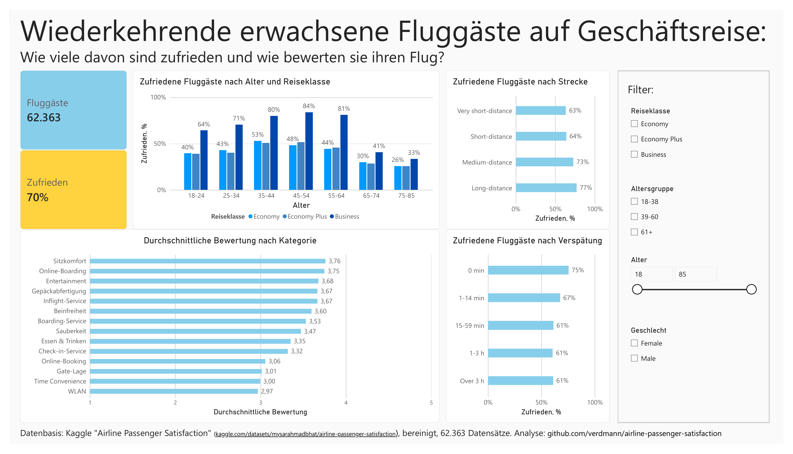
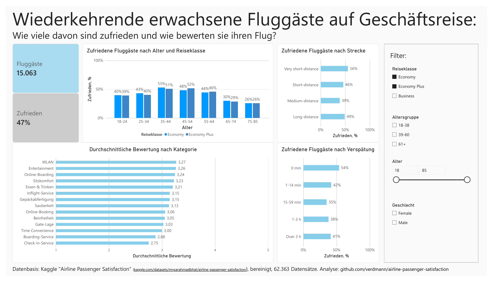

# Analyse der Fluggastzufriedenheit (Airline Passenger Satisfaction)

**XDi Capstone-Projekt · Oktober 2026 · Valeria Erdmann**

👉 **[Notebook ansehen (nbviewer)](https://nbviewer.org/github/verdmann/airline-passenger-satisfaction/blob/main/Erdmann_Capstone_AirlinePassengerSatisfaction_2026.ipynb)** - empfohlen, da GitHub große Notebooks oft nicht anzeigt.

## Worum geht es?
Welche Faktoren hängen mit der Zufriedenheit von Fluggästen zusammen und wo sollte eine Airline ansetzen? Explorative Analyse, Segmentierung und Priorisierung auf Basis des Kaggle-Datensatzes "Airline Passenger Satisfaction" (129.880 Zeilen, 24 Spalten).

## Vorgehen
1. **Datenaufbereitung** - Bereinigung, Umgang mit 0-Bewertungen ("nicht zutreffend"), Feature Engineering, Log-Transformation
2. **Datenprüfung** - Plausibilitäts- und Sensitivitätsanalysen (Ergebnisse mit und ohne auffällige Datensätze)
3. **Explorative Analyse** - Gruppenvergleiche, Kreuztabellen, Visualisierungen
4. **Segmentierung** - Entscheidungsbaum (DecisionTreeClassifier)
5. **Zusammenhänge** - Spearman-Korrelation
6. **Priorisierung** - Importance-Performance-Analyse

## Datenartefakte und Eingrenzung
Im Verlauf habe ich drei auffällige Datensegmente entdeckt und ausgeschlossen (u.a. waren alle Fluggäste mit WLAN-Bewertung 0="nicht zutreffend" zu 100 % zufrieden). Die finale Analyse basiert auf **62.363 wiederkehrenden erwachsenen Geschäftsreisenden**.

| Schritt | Ausgeschlossen | Verbleibend |
|---|---:|---:|
| Rohdaten | - | 129.880 |
| Seltene 0-Bewertungen | 737 | 129.143 |
| WLAN-Artefakt | 3.675 | 125.468 |
| Privatreisenden-Artefakt | 39.009 | 86.459 |
| Minderjährige auf Geschäftsreise | 2.739 | 83.720 |
| Neukunden-Artefakt | 21.357 | 62.363 |

## Wichtigste Erkenntnisse
- 70 % sind zufrieden, entscheidend sind Reiseklasse (Business 78 % vs. Economy/Economy Plus 47 %) und Alter.
- Am zufriedensten: Business Class, 39–60 Jahre (84 %). Am wenigsten zufrieden: 61+ (41 %) und Economy/Economy Plus (47 %).
- Handlungsbedarf laut IPA nur in diesen beiden Segmenten:
  - **61+:** Boarding, Kabinenpersonal, Gepäckabfertigung, Beinfreiheit, Entertainment
  - **Economy/Economy Plus:** Entertainment, WLAN, Sauberkeit, Sitzkomfort, Verpflegung, Online Boarding
- Empfehlungen sind Hypothesen, die vor einer Umsetzung zu prüfen wären (z. B. A/B-Tests).

## Einschränkungen
- Datensatz sehr wahrscheinlich synthetisch
- Ergebnisse gelten nur für wiederkehrende erwachsene Geschäftsreisende
- Korrelationen, keine Kausalität

## Interaktives Dashboard (Power BI)
Ergänzend zur Analyse in Python habe ich die finale Analysebasis (62.363 wiederkehrende erwachsene Geschäftsreisende) als interaktives Dashboard in Power BI aufbereitet. Datengrundlage ist der bereinigte Datensatz aus dem Notebook. Filter nach Reiseklasse, Altersgruppe, Alter und Geschlecht aktualisieren alle Visuals gleichzeitig.

*Gesamtansicht: 62.363 Fluggäste, 70 % zufrieden.*

*Gefiltert auf Economy/Economy Plus: Die Zufriedenheit sinkt auf 47 %, die Kartenfarben passen sich automatisch an.*

**Umsetzung**
- **Power Query:** Entpivotieren der 14 Bewertungskategorien in eine eigene Bewertungstabelle, Sortierspalten für Kategorien
- **Datenmodell:** 1:n-Beziehung zwischen Fluggast- und Bewertungstabelle (über `id`), damit Filter auch die Bewertungen einschränken
- **DAX:** Measures für Zufriedenheitsquote, Anzahl Fluggäste und Ø-Bewertung
- **Bedingte Formatierung:** Kartenfarben abhängig von Zufriedenheitsquote und Segmentgröße
- **Datenschnitte** für Reiseklasse, Altersgruppe, Alter und Geschlecht

Power BI-Datei: [`Capstone_PowerBI_Dashboard_final.pbix`](Capstone_PowerBI_Dashboard_final.pbix) (zum Öffnen wird Power BI Desktop benötigt)

## Tools
Python, pandas, NumPy, matplotlib, seaborn, scikit-learn, Jupyter, Power BI (Power Query, DAX)

## Daten
[Airline Passenger Satisfaction auf Kaggle](https://www.kaggle.com/datasets/mysarahmadbhat/airline-passenger-satisfaction) (CC0: Public Domain). Zum Ausführen `airline_passenger_satisfaction.csv` und `data_dictionary.csv` in denselben Ordner wie das Notebook legen.
